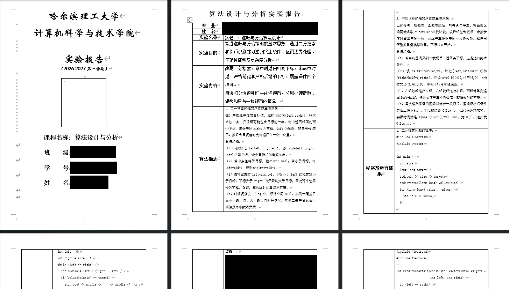
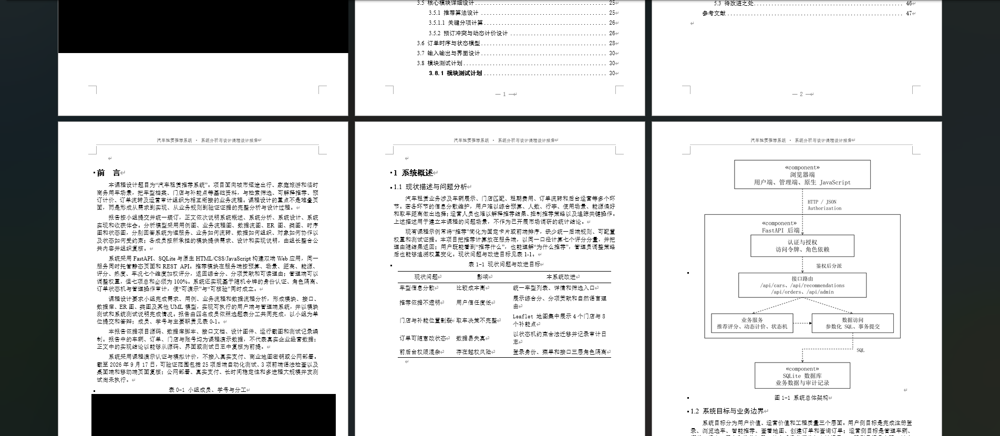
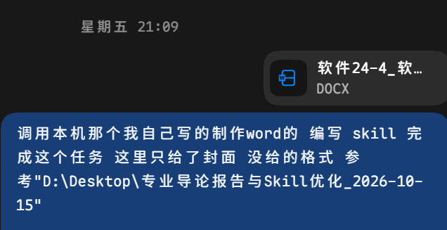

# 更适合哈理工宝宝体质的 Word 报告 Skill

[下载最新 Release](https://github.com/2258009564/project-to-template-report/releases/latest) · [查看所有版本](https://github.com/2258009564/project-to-template-report/releases)

**交给它模板和材料，说一句话，把写报告、改表达、套格式和检查页面交给 AI。**

课程报告、实验报告、课程设计，麻烦的往往不止是“写点内容”：老师给的封面不能动，正文得按模板来，目录要能更新，图表要放得下；换一次会话，又得重新交代姓名、学号和自己的要求。

`project-to-template-report` 把这些事串成一套工作流程：读懂模板 → 整理材料 → 编写正文 → 自主审稿 → 写入 Word → 检查版式。它还会在你授权后记住常用信息和明确反馈，让下一份报告更贴合你的习惯。

> **实测：一句话发起，一次完成约 15 页 Word 报告。**
>
> 作者提供的一次实际使用记录：**用时约 20 分钟，消耗 Plus 五小时额度约 8%。**
>
> 单次使用结果供参考，实际耗时与额度消耗会随模板复杂度、所用模型和运行环境变化。

## 怎么用？复制一句话就行

**已经是 AI 时代了，把下面这段话复制给你的 AI 助手（harness）即可：**

```text
请读取 https://github.com/2258009564/project-to-template-report ，按你支持的方式安装并使用这个 Skill，帮我完成这份报告。
```

装好之后，把报告模板交给它，平时只需要说：

> 根据我的 Word 制作 Skill，帮我完成以下报告。

**模板里写了什么要求，助手就自己读、自己拆解、接着做。** 章节要写什么、哪里需要图表、哪些格式要保留，都从模板中识别；正文编写、图表生成、审稿和页面检查按流程完成，不需要你逐项提醒。模板已包含题目和充分要求时，可以只给模板启动；涉及实际项目或实验结果，再使用已有材料或补充必要事实。

这里需要能访问本地文件、调用工具的 AI 助手。内置自动化使用 Windows 上的 Microsoft Word；具体环境与手动安装方法放在本文后半部分。

### 也可以一行安装

已经在用支持 Skills 的 AI 工具？在终端运行：

```sh
npx skills add 2258009564/project-to-template-report -g
```

按提示选择要安装到的 AI 工具即可，`-g` 表示跨项目使用。需要 Node.js 22.20 或更新版本；安装方式由开源 [Skills CLI](https://github.com/vercel-labs/skills) 提供。安装后，仍然只需把模板交给助手，说一句“帮我完成这份报告”。

不想使用命令行，也可以从 [Release](https://github.com/2258009564/project-to-template-report/releases/latest) 下载 `project-to-template-report-v1.0.0.zip`，解压后交给助手导入。安装 Skill 不会自动安装 Microsoft Word 等本地运行工具。

## 一次生成，报告长这样

以下是作者提供的三份报告截图，**均为一次性生成的成果**。姓名、学号、班级、教师信息及其他可识别个人身份的内容已遮盖，保留原始页面布局供查看。

### 算法设计与分析实验报告

从封面到实验说明、算法描述和代码，沿用老师提供的表格模板组织内容。



### 软件体系结构与设计模式报告

封面、目录、分级标题与正文表格，放在同一套模板中排版。


### 系统分析与设计课程报告

正文分析、对比表格和系统架构图一起生成、编排，图表与对应章节衔接。



## 真实使用时，需求就可以这么随意

指定材料位置、文件命名，再说一句“帮我做”：


手里只有老师给的封面和格式参考，也可以直接交代从哪里开始：



**先把模板给它，再用自己的话说清楚想做什么，就能高效推进。** 正文素材、项目代码和作业要求有多少给多少；模板决定格式，具体内容依据实际材料编写，需要补充的信息会明确指出。

**其他学校的同学当然也可以用。** 把自己的模板和要求交给助手，就能开始。如果效果还不够贴合，也可以在现有框架上调整模板规则、审稿要求或生成流程，逐步适配自己学校的规范。

## 模板里要求的图和表，不用再提醒一遍

**模板写着“此处应有流程图”“插入系统架构图”“用表格展示对比结果”，这些就是任务要求。** 即使你只说了“帮我完成报告”，助手也会主动识别这些提示，生成对应的图表、配好说明并插入 Word，再一起排版和检查。你不用把模板里的要求重新说一遍。

图片会结合对应章节组织：业务流程画成流程图，系统结构整理成架构图，交互和设计用合适的 UML 表达，已有数据可以生成统计图。表格会按内容整理成功能清单、方案对比或数据汇总，生成后仍可在 Word 中编辑。图题、表题、正文说明和最终页面检查都包含在流程里。

**模板没有明确标注，也可以按内容需要补充。** 在允许编辑的范围内，助手会判断哪里适合用图说明、哪里适合用表对比；你临时想加一张图或一份表，也可以直接补一句要求，沿用现有流程完成。

模板能告诉助手要做什么，但真实的实验数据、项目实现和测试结果仍需依据已有事实。缺失这类信息时会明确指出，不会把编造的内容当成结果。绘图与导出工具由助手按任务和本地环境选用，具体要求见后面的运行环境说明。

## 越用，越贴合你的习惯

在模板适配之外，它还支持进一步贴合每个人的使用习惯：

**你说过的信息，下次接着用。** 姓名、学号、班级、专业等常用字段，在授权后保存在本地，后续相关任务先读档案。更新过的信息以最新说明为准，教师、日期和组员按本次任务核对。

**你指出的问题，下次少犯一次。** “这段太空泛”“不要把没实现的功能写成做完了”“这个要求只针对本次模板”——明确反馈会形成有适用范围的本地记录，后续写作与检查会用上它。反馈越具体，积累下来的个人习惯就越有用。

**模板跟着老师走，表达贴着你的要求改。** 封面、章节、页眉页脚和指定保护区域优先保留，正文按模板实际格式组织。本次要求优先于旧习惯，一份作业的特殊规定不会自动套到所有报告上。

## 交给它之后，它会做什么

| 你关心的事 | 助手按技能流程处理 |
| --- | --- |
| 老师给的格式要保留 | 读取模板，划清可编辑范围，在副本上编写，保留指定保护区域。 |
| 正文不能只是凑字数 | 根据已有材料组织内容；项目报告可结合实际代码和测试证据。 |
| 读起来要顺 | 先单独审稿，检查语义、逻辑、重复和事实一致性，修复后再写入 Word。 |
| 模板已经写了要有图 | 主动识别图示要求，根据内容生成并插入流程图、架构图、UML 或数据图表。 |
| 模板要求用表格展示 | 主动整理成可编辑的 Word 表格，按模板处理表头、边框、对齐和跨页显示。 |
| 目录、图表和正文要协调 | 按模板批量排版，生成可更新的目录，处理表格、图片与标题。 |
| 最后别在页面上翻车 | 更新分页和字段，逐页检查目录、页码、图表与文字溢出。 |
| 下次不要从头交代 | 在授权后读取本地个人档案和反馈记录，复用相关信息与习惯。 |

## 记住你，也把隐私留在本地

个人资料和反馈笔记放在 **Skill 目录之外**。分享这份技能时，不需要连同姓名、学号和使用习惯一起分享；公开仓库也不包含作者的个人档案。

希望长期复用时，可以告诉助手：

> 我授权你把常用个人信息和我对 Word 报告的明确偏好记在本地，后续相关任务直接复用；只针对本次任务的要求不要当成长期习惯。

你也可以要求不记录或撤回授权。“学习”通过后续任务读取本地笔记实现，不涉及模型训练，也不会在会话结束后自行运行。

---

## 想自己安装或继续改？从这里开始

前面的一句话适合直接交给助手处理。下面提供手动部署、运行环境和验证方式，方便自行维护。

### 手动安装与宿主能力

可以通过前面的 `npx` 命令安装、从 Release 下载版本包，或自行克隆仓库：

```sh
git clone https://github.com/2258009564/project-to-template-report.git
```

将仓库按所用工具的 Skills 规范导入，保留 `SKILL.md`、`references/` 和 `scripts/` 的相对目录关系。也可以让具备本地工具权限的助手直接读取 `SKILL.md` 并执行流程。

技能不限定某一个 AI 产品。完整运行需要宿主能够加载说明、读写本地文件和执行脚本；不同宿主尚未逐一验证。仅能聊天、无法访问本地文件或调用工具的界面，不能独立完成自动生成。

### 运行环境与生成边界

| 部分 | 要求与职责 |
| --- | --- |
| Word 自动化 | Windows、Microsoft Word、PowerShell；`scripts/word_report.ps1` 通过 Word COM 提取实际格式并生成文档。 |
| 结构核验 | Python 辅助脚本，用于 OOXML 结构与模板约束检查。 |
| 页面检查 | 可用的 DOCX 渲染器，或将 Word 导出的内部 PDF 渲染成页面图片的工具。仓库不包含 `render_docx.py`，最终分页以 Word 为准。 |
| 可选图示 | 按任务配置绘图与导出工具；UML、项目取证等流程按需启用。 |

内置生成器适合从唯一指定的段落开始替换到文末，边界前内容保留；任意局部修改或复杂格式迁移需要额外的受限适配。只改格式的任务保留原文，需要重写时应明确可编辑范围。

完成质量取决于所用模型、材料和模板。模板提供格式依据，不能替代项目事实；缺失的事实会留空或明确说明。文案审查与页面核验是执行流程中的要求，仍需助手实际运行并确认结果。

### 本地记忆约定

当前默认记录位置为 `$CODEX_HOME/memories/extensions/ad_hoc/notes/`，未设置该变量时使用 `~/.codex/memories/extensions/ad_hoc/notes/`。这是现有流程沿用的本地路径约定，其他宿主也需要能够访问该位置。

个人档案以 `word-report-profile-v1` 标记，反馈记录以 `word-report-learning-v1` 标记，记录来源、日期、适用范围及核验状态。发布或二次分发时，不要打包私人笔记、实际报告和含个人信息的日志；`.gitignore` 只能辅助，不能代替发布审查。

### 检查与验证

在仓库根目录运行：

```powershell
python scripts/check_package.py
./scripts/test_word_report.ps1 -WorkDir "$env:TEMP/word-report-synthetic-test"
```

前者检查发布文件、本地引用、Python 语法和常见泄露特征；后者用合成 Word 模板检查格式提取、缓存、目录、混合格式拒绝和原文件保护。这些检查不能代替真实报告的审稿与逐页验收，也不证明所有宿主兼容或跨会话召回效果。

### 继续阅读与贡献

入口见 [SKILL.md](SKILL.md)，文案审查见 [content-review.md](references/content-review.md)，本地记忆见 [local-learning.md](references/local-learning.md)，版式核验见 [verification-and-delivery.md](references/verification-and-delivery.md)。

以 [MIT License](LICENSE) 开源。欢迎带着真实模板、使用反馈和可复现的问题一起完善；提交前请移除个人信息。
